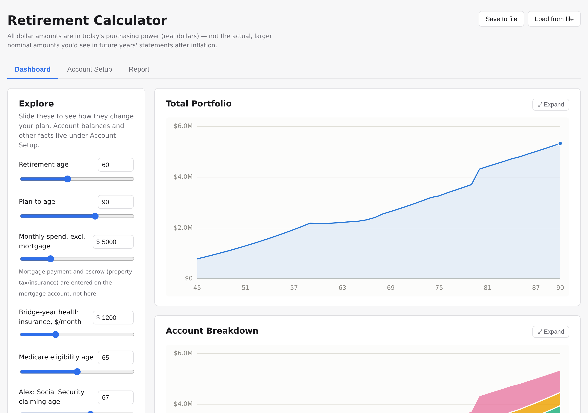
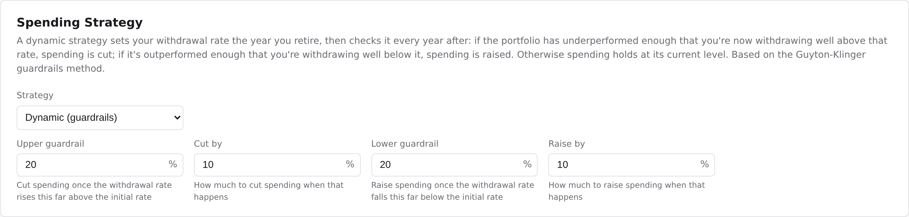
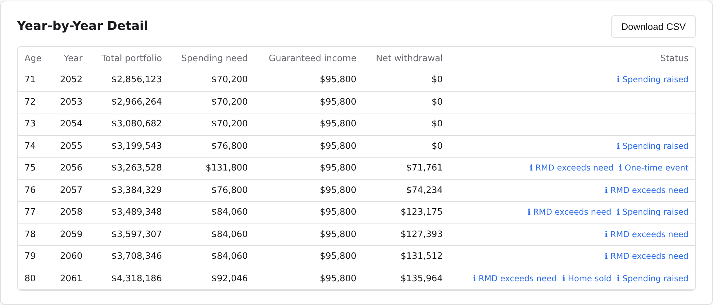
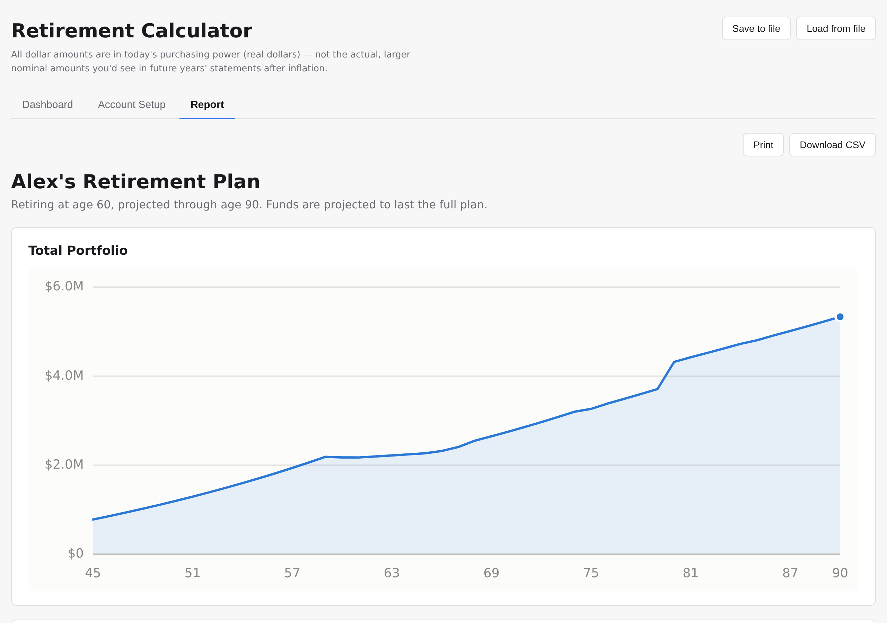

# Retirement Calculator

A personal, interactive retirement projection tool. You enter your accounts, income
sources, and spending, and it projects your balance year by year out to whatever age
you want to plan for — plus a Monte Carlo view of how uncertain market returns affect
the odds the plan actually holds up.

It's loosely inspired by a spreadsheet I was using before this, not a clone of any
commercial product. Everything runs in your browser — there's no server, no account,
no company on the other end of this collecting your numbers.



*(All screenshots use made-up demo data — [`demo-plan.json`](./demo-plan.json) — not
anyone's real finances.)*

## What it does

- Tracks any mix of accounts: taxable brokerage, 401(k)/IRA, Roth, a cash reserve, a
  mortgage, and a home.
- Handles a two-person household — a spouse can have their own age, accounts,
  pension, and Social Security benefit.
- Models Social Security (pick a claiming age, see the tradeoff), pensions (including
  a FERS-style federal pension), and Required Minimum Distributions once you hit the
  age the IRS requires them.
- Estimates real income tax — current federal brackets plus a flat state rate you set
  — and withdraws from your accounts in a sensible order (not just "the biggest
  balance first").
- Flags withdrawals taken before age 59½ so you can see the penalty coming.
- Models your mortgage (including extra payments and escrow) and, optionally, selling
  your home partway through retirement, including the tax exclusion that usually
  applies.
- Lets you add one-time events — an inheritance, a major expense, a recurring cost —
  at whatever age they'd happen.
- Supports two spending styles: a fixed amount every year, or a "guardrails" strategy
  that automatically trims spending after a bad stretch of returns and loosens up
  after a good one.
- Runs a Monte Carlo simulation using real historical market returns (not a made-up
  bell curve) to show your odds of success, not just one straight-line guess.
- Gives you sliders to drag — retirement age, spending, claiming ages — and watch the
  whole plan update live.
- Exports the year-by-year numbers to a CSV, and has a clean printable report page.
- Saves and loads your plan as a plain file on your own computer.

## What it assumes

- All dollar amounts are shown in today's purchasing power (inflation already backed
  out), not the bigger nominal numbers you'd actually see on a future statement. The
  one exception is mortgage principal & interest, which behaves like a real mortgage
  (a fixed payment in actual dollars).
- Your whole portfolio grows at one blended average rate you set, rather than
  separate rates per account or asset class. The Monte Carlo view is the exception —
  it samples real historical stock market returns instead.
- It uses this year's tax brackets, standard deduction, and retirement account
  contribution limits. Those change every year, and this tool doesn't update itself
  automatically.
- State income tax is a single flat rate you enter, not your actual state's real
  bracket structure.
- If you don't tell it what you've already paid into a taxable or Roth account (your
  "cost basis"), it assumes none of it is gains yet — worth double-checking if that's
  not close to true for you.
- A two-person household shares one retirement date, one spending plan, and one
  mortgage timeline — it doesn't model two fully independent retirements under one
  roof.

## What it doesn't do

- It's not hosted anywhere, and it's not trying to be — you run it yourself, and your
  numbers stay on your machine. There's no login, no cloud save, and no undo: if you
  close the tab without saving, unsaved edits are gone.
- No side-by-side comparison of multiple scenarios at once — one plan at a time.
- No rental property, long-term-care cost modeling, or life insurance.
- No buying a new home after selling one, and no modeling more than one sale.
- It doesn't tell you the "best" answer — the best Social Security age, the smartest
  Roth conversion — it just shows you what a given choice does. You're the one
  turning the knobs.
- It hasn't been reviewed by a financial professional, and it isn't financial advice.
  It's a personal tool I built for my own planning, shared as-is. Sanity-check
  anything important against your own judgment (or an actual advisor) before you act
  on it.

## More screenshots

The dynamic "guardrails" spending strategy, set on the Setup tab:



The year-by-year table, flagging RMDs, a home sale, and guardrails adjustments as
they happen, with a one-click CSV export:



A clean, printable report — one click away from a PDF via your browser's own print
dialog:



## Yes, this was built with AI

Most of the code, and most of this README, came out of Claude. I used it because I
didn't have the time, energy, or particular desire to spend months reinventing the
wheel. Some people will hate that. That's fine. Without AI, this tool almost
certainly wouldn't exist, so I'll take the imperfect thing that actually got built
over the beautifully hand-crafted tool that remained a hypothetical project in my
head.

## Getting started

You'll need [Node.js](https://nodejs.org/) (the LTS version is fine — this was built
and tested on Node 24) and [Git](https://git-scm.com/).

### Windows

1. Install Node.js from [nodejs.org](https://nodejs.org/) — grab the LTS installer
   and run it (this also installs `npm`).
2. Install [Git for Windows](https://git-scm.com/download/win), which gives you Git
   Bash — or just download this repo as a ZIP from GitHub's green "Code" button
   instead, if you'd rather skip Git entirely.
3. Open Git Bash (or PowerShell / Command Prompt) and run:

   ```bash
   git clone <this-repo-url>
   cd retirement-calc   # or whatever folder it cloned into
   npm install
   npm run dev
   ```

4. Open the URL it prints (usually `http://localhost:5173`) in your browser.

### Linux (and macOS)

1. Install Node.js — via your distro's package manager, from
   [nodejs.org](https://nodejs.org/), or with [nvm](https://github.com/nvm-sh/nvm) if
   you want to manage versions.
2. Git is usually already installed; if not, `sudo apt install git` (Debian/Ubuntu),
   `sudo dnf install git` (Fedora), or `brew install git` (macOS).
3. In a terminal:

   ```bash
   git clone <this-repo-url>
   cd retirement-calc   # or whatever folder it cloned into
   npm install
   npm run dev
   ```

4. Open the URL it prints (usually `http://localhost:5173`) in your browser.

### Everyday commands

```bash
npm run dev     # start the local server (do this every time you want to use it)
npm test        # run the automated test suite
npm run build   # type-check and build a production bundle
npm run lint    # run the linter
```

Your data never leaves your machine: there's no database and nothing is uploaded
anywhere. Use "Save to file" in the app to keep a copy of your plan, and "Load from
file" to bring it back next time — closing the tab without saving loses your edits.
